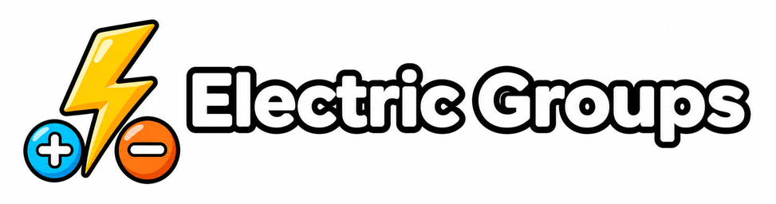

[English documentation](README.md)

*Bitte vergib einen* :star:, *wenn du diese Integration nützlich findest!* :blush:

# Electric Groups

Electric Groups fasst in Home Assistant Energieverbrauch (kWh) und Leistungsaufnahme (W) verschiedener Geräte zu Gruppen zusammen. Jede Gruppe erscheint als virtuelles Gerät.

## Summen- und Differenzgruppen

### Summengruppe

Eine **Summengruppe** zeigt, was die ausgewählten Verbraucher zusammen benötigen. Sie addiert den Energieverbrauch in kWh und die aktuelle Leistung in W jeweils separat. So kannst du zum Beispiel die Leuchten eines Raums gemeinsam auswerten. Haben zwei Leuchten im selben Zeitraum 0,1 kWh und 0,2 kWh verbraucht, sind es zusammen 0,3 kWh. Ziehen sie gleichzeitig 15 W und 25 W, zeigt der Leistungssensor 40 W.

#### Energiehistorie beim Austausch eines Messgeräts

Wenn du das Messgerät eines Verbrauchers austauschst, kann eine Summengruppe den Verbrauch vor und nach dem Wechsel in einer gemeinsamen Energiehistorie zusammenführen. Dazu wählst du beim Anlegen die Energieentitäten des alten und des neuen Messgeräts aus und aktivierst **Energiehistorie übernehmen**. Die alte Entität muss zu diesem Zeitpunkt noch auswählbar sein. Die Gruppe übernimmt die vorhandenen Langzeitstatistiken beider Messgeräte.

Wenn das alte Messgerät nach dem Wechsel nicht mehr verfügbar ist, rechnet die Gruppe bei ausgeschaltetem Schalter **Alle Entitäten erforderlich** mit den Messwerten des neuen Geräts weiter.

### Differenzgruppe

Eine **Differenzgruppe** verwendet einen vorgeschalteten Zähler als Basis und zieht davon die Messwerte der ausgewählten Verbraucher ab. Damit das Ergebnis dem Verbrauch der übrigen Geräte entspricht, muss die Basis auch die abzuziehenden Verbraucher erfassen. Wenn der Basiszähler auch Leistung misst, kann die Gruppe auf dieselbe Weise die aktuelle Leistung der übrigen Geräte berechnen.

Eine smarte Zwischensteckdose misst zum Beispiel den Gesamtverbrauch an einer Mehrfachsteckdose. Zwei weitere Zwischensteckdosen an der Leiste messen einen Monitor und einen Computer einzeln. Die vorgeschaltete Zwischensteckdose ist das Basisgerät, die anderen beiden sind Mitglieder der Differenzgruppe. Misst die Basis 10 kWh und verbrauchen Monitor und Computer im selben Zeitraum 3 kWh und 5 kWh, bleiben 2 kWh für die übrigen Geräte an der Leiste.

## Installation

Voraussetzung ist Home Assistant ab 2026.11.2.

### Über den Marketplace

1. Öffne in Home Assistant **Einstellungen → Marketplace**. Wähle oben rechts die Option zum Hinzufügen über einen Link.
2. Verbinde dein GitHub-Konto, falls der Marketplace dich dazu auffordert.
3. Gib als GitHub-Link `https://github.com/jan-brinkmann/ha-electric-groups` ein und wähle **Hinzufügen**. Falls der Marketplace nach dem Typ fragt, wähle **Integration** und bestätige erneut mit **Hinzufügen**.
4. Öffne **Electric Groups** im Marketplace, wähle **Installieren** und bestätige die Installation. Wenn Home Assistant einen Neustart anfordert, führe ihn aus.

### Manuelle Installation

1. Lade ein ZIP-Archiv aus dem GitHub-Repository herunter. Eine veröffentlichte Version findest du unter **Releases → Source code (zip)**, den aktuellen Stand unter **Code → Download ZIP**. Entpacke das Archiv.
2. Öffne das Home-Assistant-Konfigurationsverzeichnis, in dem `configuration.yaml` liegt. Bei Home Assistant OS ist das üblicherweise `/config`. Bei Home Assistant Container ist es der Ordner, den du als `/config` eingebunden hast. [Konfigurationsverzeichnis finden](https://www.home-assistant.io/docs/configuration/#to-find-the-configuration-directory)
3. Kopiere aus dem Archiv den kompletten Ordner `custom_components/electric_groups` in den Ordner `custom_components` deiner Home-Assistant-Konfiguration. Lege `custom_components` an, falls der Ordner noch fehlt. Danach liegt `manifest.json` unter `custom_components/electric_groups/manifest.json`, relativ zum Konfigurationsverzeichnis.
4. Starte Home Assistant neu.

### Electric Groups einrichten

Wenn der Marketplace nach der Installation den Einrichtungsdialog öffnet, bestätige dort die Einrichtung. Andernfalls öffne **Einstellungen → Geräte & Dienste → Integration hinzufügen**, suche nach **Electric Groups** und bestätige die einmalige Einrichtung.

## Gruppen erstellen und bearbeiten

### Gruppe erstellen

1. Öffne **Einstellungen → Geräte & Dienste → Electric Groups** und wähle **Summengruppe hinzufügen** oder **Differenzgruppe hinzufügen**.
2. Trage unter **Gruppenname** ein, wie das virtuelle Gerät in Home Assistant heißen soll.
3. Wähle bei einer Differenzgruppe genau ein **Basisgerät** mit genau einem aktivierten, kompatiblen Energiesensor. Die Gruppe bekommt einen Leistungssensor, wenn das Basisgerät mindestens einen aktivierten, kompatiblen Leistungssensor hat.
4. Wähle mindestens ein Gerät oder einen einzelnen Sensor aus. Du kannst Geräte und einzelne Sensoren kombinieren.

   - Bei einer Summengruppe wählst du unter **Geräte**, **Energiesensoren** und **Leistungssensoren** aus, welche Werte addiert werden sollen.
   - Bei einer Differenzgruppe legst du unter **Abzuziehende Geräte**, **Abzuziehende Energiesensoren** und **Abzuziehende Leistungssensoren** fest, welche Werte vom Basisgerät abgezogen werden sollen.

5. Aktiviere bei Bedarf **Energiehistorie übernehmen**, um die Verbrauchshistorie der Gruppe aus den vorhandenen Langzeitstatistiken der ausgewählten Energieentitäten zu berechnen. Der Energiesensor der Gruppe lässt sich zum Energie-Dashboard hinzufügen, um diese Historie dort anzuzeigen.
6. Bestätige die Auswahl. Die Sensoren findest du auf der Geräteseite der Gruppe.

Wenn du ein Gerät als Mitglied auswählst, übernimmt die Gruppe beim Speichern alle seine aktivierten, kompatiblen Sensoren für die Messgrößen, die sie berechnet. Liefert das Gerät sowohl einen Gesamtwert als auch Werte für einzelne Kanäle, wähle die gewünschten Sensoren einzeln aus, um Doppelzählungen zu vermeiden. Derselbe Sensor zählt einmal, auch wenn du ihn auf beiden Wegen auswählst.

Bei einer Summengruppe bleibt der Gruppensensor für eine Messgröße ohne ausgewählte Entitäten nicht verfügbar.

### Gruppe bearbeiten oder entfernen

Öffne unter **Einstellungen → Geräte & Dienste → Electric Groups** das Menü neben der Gruppe. Dort kannst du die Gruppe bearbeiten oder entfernen. Beim Bearbeiten kannst du den Namen und die Auswahl der Geräte und Sensoren ändern. Bei einer Differenzgruppe kannst du auch ein anderes Basisgerät wählen.

Wenn ein als Mitglied ausgewähltes Gerät neue kompatible Sensoren bekommt, speichere die Gruppe erneut, um diese Sensoren einzubeziehen. Beim Speichern bleibt der bisherige Gruppenverbrauch erhalten. Der erste Messwert eines neu hinzugefügten Zählers dient als Ausgangspunkt für die weitere Berechnung.

## Energie und Leistung

Der **Leistungssensor** zeigt die aktuelle Leistung in W. Der **Energiesensor** berechnet den Verbrauch in kWh aus den Änderungen der Zählerstände. Ohne Historienimport beginnt der Gruppenverbrauch bei 0 kWh.

Bei einer Differenzgruppe aktualisiert sich der Energieverbrauch im Normalbetrieb, sobald der Energiesensor des Basisgeräts einen Zählerstand meldet.

Beim **Import der Energiehistorie** verrechnet die Gruppe die bereits aufgezeichneten Verbrauchsdaten. Bei einem Zähler ohne Verlaufsdaten dient der erste aktuelle Messwert als Ausgangspunkt. Wenn du die Verlaufsaufzeichnung eingeschränkt hast, achte darauf, dass Home Assistant auch den Energiesensor der Gruppe aufzeichnet.

## Wenn Geräte nicht verfügbar sind

Geräte können vorübergehend nicht verfügbar sein, etwa wenn ein Cloud-Dienst ausfällt oder die Funkverbindung abbricht.

Auf der Geräteseite jeder Gruppe findest du unter **Konfiguration** den Schalter **Alle Entitäten erforderlich**. Die Einstellung gilt für Energie und Leistung jeweils separat und wird für jede Gruppe gespeichert.

- **Ein (Standard für neue Gruppen).** Ist eine Energie- oder Leistungsentität nicht verfügbar, wird der entsprechende Gruppensensor ebenfalls als nicht verfügbar angezeigt. Nach einem Ausfall zeigt der Energiesensor erst wieder einen Wert an, wenn alle Energieentitäten wieder verfügbar sind und danach jeweils einen Messwert gemeldet haben. Auch eine erneute Meldung mit demselben Zählerstand zählt.
- **Aus.** Die Gruppe rechnet mit den verfügbaren Messwerten. Meldet ein Energiezähler nach einem Ausfall wieder einen Wert, zählt die Gruppe ab seinem letzten gültigen Stand weiter. Fallen alle ausgewählten Leistungssensoren einer Summengruppe aus, zeigt sie 0 W. Eine Differenzgruppe braucht mindestens einen verfügbaren Basis-Leistungswert, um die Leistung anzuzeigen.

## Beispiel für das Energie-Dashboard

Für die Mehrfachsteckdose aus dem Beispiel oben lassen sich im Energie-Dashboard die Einzelsensoren für Monitor und Computer und der Energiesensor der Differenzgruppe für die übrigen Geräte verwenden. Ein zusätzlicher Eintrag der vorgeschalteten Zwischensteckdose unter den Einzelgeräten würde den Verbrauch doppelt zählen. Wenn die Zähler zu unterschiedlichen Zeiten melden, kann der Wert der Differenzgruppe vorübergehend sinken oder negativ werden.

## Lizenz

Dieses Projekt wird unter der [MIT-Lizenz](LICENSE) veröffentlicht. Sie erlaubt
insbesondere die private und kommerzielle Nutzung, Änderung, Weiterentwicklung und
Weitergabe. Bei Kopien oder wesentlichen Teilen der Software müssen der
Copyright-Hinweis und der Lizenztext erhalten bleiben.

Teile dieses Projekts wurden mit Unterstützung generativer KI, darunter OpenAI
Codex, erstellt und anschließend menschlich geprüft und weiterbearbeitet. Daraus
entstehen keine zusätzlichen Einschränkungen gegenüber der MIT-Lizenz.
