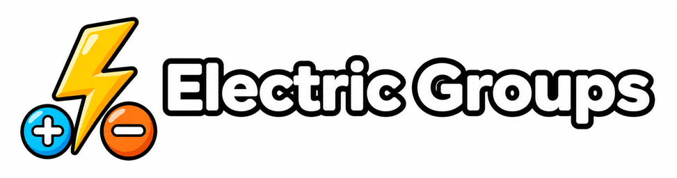

[Deutsche Dokumentation](README.de.md)

*Please leave a* :star: *if you find this integration useful!* :blush:

# Electric Groups

Electric Groups combines energy consumption (kWh) and power draw (W) from different devices into groups in Home Assistant. Each group appears as a virtual device.

## Sum and difference groups

### Sum group

A **sum group** shows how much the selected devices use together. It adds up energy consumption in kWh and current power in W separately. For example, you can track the lights in a room as a group. If two lights use 0.1 kWh and 0.2 kWh over the same period, their combined consumption is 0.3 kWh. If they draw 15 W and 25 W at the same time, the power sensor shows 40 W.

#### Keeping energy history when replacing a meter

When you replace the meter for a device, a sum group can combine consumption from before and after the change into a single energy history. When creating the group, select the energy entities of both meters and enable **Import energy history**. The old entity still needs to be selectable at that point. The group imports the existing long-term statistics from both meters.

If the old meter becomes unavailable after the replacement, the group continues with readings from the new meter when **Require all entities** is off.

### Difference group

A **difference group** uses an upstream meter as its base and subtracts the readings of selected devices. The base meter needs to cover the devices you subtract for the result to represent the remaining devices. If the base meter also measures power, the group can calculate the remaining devices' current power in the same way.

For example, one smart plug measures total consumption on a power strip. Two more smart plugs on the strip measure a monitor and a computer individually. The upstream plug is the base device, and the other two are members of the difference group. If the base records 10 kWh and the monitor and computer use 3 kWh and 5 kWh over the same period, that leaves 2 kWh for the other devices on the strip.

## Installation

Requires Home Assistant 2026.11.2 or later.

### Through the Marketplace

1. In Home Assistant, open **Settings → Marketplace** and select **Add from link** in the upper-right corner.
2. Connect your GitHub account if the Marketplace prompts you to do so.
3. Enter `https://github.com/jan-brinkmann/ha-electric-groups` under **GitHub link** and select **Add**. If the Marketplace asks for the type, select **Integration** and select **Add** again.
4. Open **Electric Groups** in the Marketplace, select **Install**, and confirm the installation. Restart Home Assistant if prompted.

### Manual installation

1. Download a ZIP archive from the GitHub repository. Use **Releases → Source code (zip)** for a published version or **Code → Download ZIP** for the current repository contents. Extract the archive.
2. Open the Home Assistant configuration directory where `configuration.yaml` is located. On Home Assistant OS, this is usually `/config`. On Home Assistant Container, use the directory you mounted as `/config`. [Find the configuration directory](https://www.home-assistant.io/docs/configuration/#to-find-the-configuration-directory)
3. Copy the entire `custom_components/electric_groups` folder from the archive into the `custom_components` directory of your Home Assistant configuration. Create `custom_components` if it does not exist. From the configuration directory, you should now find `manifest.json` at `custom_components/electric_groups/manifest.json`.
4. Restart Home Assistant.

### Set up Electric Groups

If the Marketplace opens the setup dialog after installation, confirm setup there. Otherwise, go to **Settings → Devices & services → Add integration**, find **Electric Groups**, and confirm setup once.

## Create or edit a group

### Create a group

1. Open **Settings → Devices & services → Electric Groups** and select **Add sum group** or **Add difference group**.
2. Enter a **Group name** for the virtual device as it should appear in Home Assistant.
3. For a difference group, select exactly one **Base device** with exactly one enabled, compatible energy sensor. The group gets a power sensor if the base device has at least one enabled, compatible power sensor.
4. Select at least one device or individual sensor. You can combine devices and individual sensors.

   - For a sum group, use **Devices**, **Energy sensors**, and **Power sensors** to choose which readings to add.
   - For a difference group, use **Devices to subtract**, **Energy sensors to subtract**, and **Power sensors to subtract** to choose which readings to subtract from the base device.

5. Enable **Import energy history** if you want to calculate the group's consumption history from the existing long-term statistics of the selected energy entities. The group's energy sensor can be added to the Energy Dashboard to display this history.
6. Confirm your selections. You can find the sensors on the group's device page.

When you save a group, it includes all enabled, compatible sensors from each selected member device for the measurements the group calculates. If the device provides both a total and readings for individual channels, select the sensors you want individually to avoid double counting. The same sensor counts once even if you select it both ways.

A sum group sensor is unavailable if you select no entities for that measurement.

### Edit or remove a group

Go to **Settings → Devices & services → Electric Groups** and open the menu next to the group. You can edit or remove the group there. When editing, you can change the name and the selected devices and sensors. For a difference group, you can also choose a different base device.

If a device you selected as a member gains compatible sensors, save the group again to include them. Saving keeps the group's accumulated consumption. The first reading from a newly added meter sets its starting point for future calculations.

## Energy and power

The **power sensor** shows current power in W. The **energy sensor** calculates consumption in kWh from changes in meter readings. Without a history import, the group starts at 0 kWh.

A difference group's energy sensor normally updates when the base device's energy sensor reports a meter reading.

When you **import energy history**, the group combines previously recorded consumption data. For a meter without history, the first live reading sets its starting point. If you have limited which sensors Home Assistant records, make sure it also records the group's energy sensor.

## When devices are unavailable

Devices can become temporarily unavailable if a cloud service goes down or a wireless connection drops.

On each group's device page, look under **Configuration** for **Require all entities**. The setting applies to energy and power separately and is saved for each group.

- **On (default for new groups).** If an energy or power entity is unavailable, the corresponding group sensor is also shown as unavailable. After an outage, the energy sensor waits until all energy entities are available again and each has then reported a reading. A repeated report with the same meter value counts.
- **Off.** The group uses the available readings. When an energy meter reports again after an outage, the group tracks changes from its last valid reading. A sum group shows 0 W if all selected power sensors are unavailable. A difference group needs at least one available base power reading to show power.

If all energy entities show valid readings again after an outage and some reports are still missing after one minute, the group appears under **Settings → Repairs**. After a restart, the wait begins once Home Assistant has finished starting and all energy entities are available again.

Open the issue to see which energy entities have yet to report and follow links to their associated devices. Select **Repair** to use the current meter readings and restore the group energy sensor. This briefly turns **Require all entities** off and back on. If you close the dialog, the energy sensor keeps waiting for reports. You can reopen the issue later.

## Example for the Energy Dashboard

For the power strip in the example above, the Energy Dashboard can use the individual sensors for the monitor and computer and the difference group's energy sensor for the remaining devices. Adding the upstream plug to the individual device totals would count the same consumption twice. If the meters report at different times, the difference group's reading can temporarily drop or go negative.

## License

This project is released under the [MIT License](LICENSE). In particular, the
license permits private and commercial use, modification, further development,
and redistribution. The copyright notice and license text must be retained in
copies or substantial portions of the software.

Parts of this project were created with the assistance of generative AI,
including OpenAI Codex, and subsequently reviewed and revised by a human. This
does not impose any additional restrictions beyond the MIT License.
